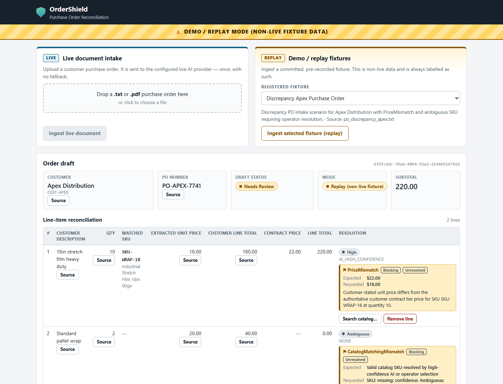

# OrderShield

A team-built purchase-order reconciliation MVP: AI extracts document fields and candidate
SKUs, deterministic code checks catalog and customer-contract rules, and an operator
resolves discrepancies before approving or rejecting the order. **AI cannot approve orders.**

Built with **Python, FastAPI, Pydantic, SQLAlchemy/SQLite, and a vanilla JavaScript UI**.
This is a local application with implemented live-provider adapters and an explicit offline
replay path; it is not a claimed production deployment.

[Try replay locally](#try-the-replay-demo) · [Engineering case study](docs/portfolio.md) · [Architecture and trust model](#architecture--trust-model) · [Evaluation evidence](#evaluation-evidence)

## Try the replay demo

From a fresh checkout with Python 3.11+, PowerShell:

```powershell
python -m venv .venv
.\.venv\Scripts\python -m pip install -r requirements.lock
.\.venv\Scripts\python -m app.cli init-db --seed
.\.venv\Scripts\python -m uvicorn app.main:app
```

Open [localhost:8000](http://127.0.0.1:8000/). In **Demo / replay fixtures**, select a
registered fixture and click **Ingest selected fixture (replay)**. No AI credentials
are needed. Keep the seeded demo database disposable; [installation](#installation)
contains POSIX activation and detailed setup instructions.

| Mode | Extraction source | Credentials and failure behavior |
| --- | --- | --- |
| Replay | Committed synthetic documents and recorded extraction payloads; real local reconciliation/lifecycle | No provider key or inference. Always labelled replay. |
| Live | One call to the selected Qwen or Gemini adapter | Requires `LLM_API_KEY`; Qwen also requires `QWEN_BASE_URL`. Configuration/transport failure returns 503, invalid AI output 502; no provider or fixture failover. |

### Replay preview



Captured locally on 22 October 2026 from the committed synthetic Apex fixture.
[Capture provenance](docs/images/README.md). This is not newly generated LLM output.

## Engineering highlights

- **Governed extraction:** provider identity, strict schemas, and exact document citations.
- **Deterministic commercial rules:** contract tiers, integer-cent arithmetic, MOQ and packaging checks.
- **Grounded operator actions:** corrections and SKU resolution re-evaluate discrepancies; approval remains explicit.
- **Inspectable evidence:** persisted provenance/audit events and separate deterministic, replay, historical, and opt-in live evaluation modes.

## Team contributions

| Contributor | Role and representative merged work |
| --- | --- |
| **Vladimir Barbalat** ([@barbalatv](https://github.com/barbalatv)) | **Team Lead / Backend & AI Integration / Verification**. Provider/backend integration [#16](https://github.com/Slave-of-Skynet/training_best2026/pull/16), discrepancy engine [#22](https://github.com/Slave-of-Skynet/training_best2026/pull/22), mutation routes [#29](https://github.com/Slave-of-Skynet/training_best2026/pull/29), evaluation runner [#48](https://github.com/Slave-of-Skynet/training_best2026/pull/48). |
| **@arseniistrokov** ([@arseniistrokov](https://github.com/arseniistrokov)) | SPA workspace [#17](https://github.com/Slave-of-Skynet/training_best2026/pull/17), grounded correction/removal [#27](https://github.com/Slave-of-Skynet/training_best2026/pull/27), provenance UI wiring [#33](https://github.com/Slave-of-Skynet/training_best2026/pull/33). |
| **@vicuvi1** ([@vicuvi1](https://github.com/vicuvi1)) | Bootstrap [#2](https://github.com/Slave-of-Skynet/training_best2026/pull/2), catalog API [#21](https://github.com/Slave-of-Skynet/training_best2026/pull/21), approved-order audit retrieval [#23](https://github.com/Slave-of-Skynet/training_best2026/pull/23). |
| **@tikotto** ([@tikotto](https://github.com/tikotto)) | Runtime/environment configuration [#4](https://github.com/Slave-of-Skynet/training_best2026/pull/4). |
| **Mr-Ressentiment** ([@Mr-Ressentiment](https://github.com/Mr-Ressentiment)) | Test harness and synthetic fixtures [#3](https://github.com/Slave-of-Skynet/training_best2026/pull/3). |

Team leadership is supplied by the project owner; implementation references are repository
evidence. Final integration [#37](https://github.com/Slave-of-Skynet/training_best2026/pull/37)
combines multiple contributors' commits and does not imply sole authorship.

## Evaluation evidence

The [case study](docs/portfolio.md#testing-and-evaluation-methodology) explains the
[protocol](docs/evaluation/protocol.md), [runner](app/evaluation/runner.py), and
[committed 2 October results](docs/evaluation/results/20261002-001259-ALL.json).
Historical provider measurements, recorded replay, and deterministic fixture checks
have different denominators. The aggregate retains failures and marks SC-001 and
SC-006 partially measured. No general model-accuracy or human-time-saved claim is made;
manual-study preparation is not a completed participant study.

## What it does

OrderShield manages the end-to-end purchase order reconciliation lifecycle:

```text
Purchase Order (.txt / .pdf)
    ↓
AI Extraction Boundary (fuzzy parsing & semantic SKU candidates)
    ↓
Deterministic Reconciliation Engine (catalog & contract pricing rules)
    ↓
Discrepancy Review & Grounded Source Evidence
    ↓
Human Operator Resolution (SKU selection, grounded field correction, line removal)
    ↓
Approval or Explicit Rejection
    ↓
Immutable Verified Order Record & Append-Only Audit Trail
```

### Core Responsibilities
- **AI Boundary**: Generates initial field extraction and semantic candidate SKU matching. AI is strictly untrusted for business calculations and approval decisions.
- **Deterministic Validation**: Executes all catalog checks, packaging increment math, integer-cents pricing tier lookups, arithmetic checks, and draft state transitions.
- **Zero Autonomous Approval**: AI models cannot approve orders. Approval strictly requires human operator action on drafts with zero unresolved blocking discrepancies (`Ready for Approval`).

### Supported Discrepancy Types
The reconciliation engine evaluates and flags four accepted MVP discrepancy categories:

1. **`PriceMismatch`**: The requested purchase order unit price does not match the customer's negotiated contract price tier for the given quantity.
2. **`QuantityOrPackagingBreach`**: The requested quantity violates the master catalog minimum order quantity (MOQ) or packaging increment rules.
3. **`ArithmeticMismatch`**: The line total does not equal `quantity * unit_price`, or the order total does not equal the sum of line totals.
4. **`CatalogMatchingMismatch`**: The extracted customer item description does not map to a single catalog SKU with high confidence (e.g., ambiguous candidate matches or unrecognized items).

---

## Architecture & Trust Model

### Architecture Overview

```text
Browser SPA (Vanilla JS / CSS / HTML)
    ↓
FastAPI Application Layer
    ├── Live AI Extraction Boundary (Qwen / Gemini)
    ├── Replay Fixture Boundary (Committed Pre-Verified Datasets)
    ├── Deterministic Reconciliation Engine (Integer Cents Math)
    ├── Operator Mutation APIs (SelectSKU, CorrectField, RemoveLine)
    ├── Order Lifecycle Management (Approve / Reject)
    └── SQLite Persistence (ORM Models, Field Provenance, Audit Events)
```

### Trust & Governance Model

- **NO Automatic Provider Failover**: The application exclusively invokes the configured primary AI provider. If the provider experiences an error, network failure, or timeout, the request fails fast and explicitly. The system never dynamically cascades to a secondary provider.
- **NO Silent Fixture Substitution**: Live intake (`/api/v1/orders/ingest`) never falls back to mock or replay fixture data upon live inference failure. Live failures return explicit HTTP diagnostics.
- **NO Commercial Overrides**: Human operators cannot arbitrarily override prices or quantities to bypass contractual agreements or catalog rules. Line corrections (`CorrectField`) require verbatim text snippets grounded in the source document.
- **NO Unresolved Approvals**: Drafts containing any unresolved blocking discrepancies cannot be approved (`DraftNotReadyForApprovalError`, HTTP 409).
- **Explicit Replay Segregation**: Offline / replay demo mode is initiated exclusively through dedicated endpoints (`/api/v1/fixtures/...`) and is permanently badged in the UI as `⚠️ DEMO / REPLAY MODE (NON-LIVE FIXTURE DATA)` with no dismiss control.
- **Auditable Provenance**: Audit events record the actual provider and model identity (e.g. `qwen / qwen3.8-flash` or `fixture / pre-verified-dataset`).

---

## Prerequisites

- **Python**: Version `3.11` or higher
- **Package Manager**: `pip`
- **Version Control**: `Git`
- **Operating System**: Windows, Linux, or macOS

> [!NOTE]
> Docker is not required. Node.js/npm is also not required; the web interface is committed static HTML, CSS, and vanilla JavaScript without any frontend build or bundling step.

---

## Installation

Clone the repository and set up a Python virtual environment:

```bash
git clone https://github.com/Slave-of-Skynet/training_best2026.git
cd training_best2026

# Create virtual environment
python -m venv .venv
```

Activate the virtual environment:

### Windows PowerShell
```powershell
.\.venv\Scripts\Activate.ps1
```

### Linux / macOS
```bash
source .venv/bin/activate
```

Install application dependencies using the reproducible dependency lock:

```bash
pip install -r requirements.lock
```

*(Note: `requirements.txt` remains the direct dependency manifest; `requirements.lock` provides exact pinned versions for deterministic setup).*

---

## Configuration

Runtime configuration is read directly from environment variables via Python `os`.

> [!IMPORTANT]
> The application does **not** automatically load `.env` files at startup. The file `.env.example` serves as a configuration reference. Set environment variables explicitly in your shell before launching the server.

### Environment Reference (`.env.example`)

```text
LLM_PROVIDER="qwen"
LLM_API_KEY=""
QWEN_BASE_URL=""
DATABASE_URL="sqlite:///ordershield.db"
LIVE_INFERENCE_TIMEOUT=15.0
```

### Configuration Variables

| Variable | Default | Description |
| :--- | :--- | :--- |
| `LLM_PROVIDER` | `"qwen"` | Live AI extraction provider. Supported options: `"qwen"` (primary: Alibaba Qwen 3.8 Flash) or `"gemini"` (alternate: Google Gemini 3.5 Flash-Lite). |
| `LLM_API_KEY` | `""` | API authentication key for the configured provider. Required for live intake. |
| `QWEN_BASE_URL` | `""` | **Required when `LLM_PROVIDER="qwen"`.** Workspace-specific approved Singapore compatible-mode base URL of the form `https://<workspace-host>.ap-southeast-1.maas.aliyuncs.com/compatible-mode/v1`. `LLM_API_KEY` alone is not sufficient for Qwen. |
| `DATABASE_URL` | `"sqlite:///ordershield.db"` | SQLAlchemy database connection URL. |
| `LIVE_INFERENCE_TIMEOUT` | `15.0` | Maximum client timeout in seconds for live AI inference before aborting. |

> [!NOTE]
> Per ADR 0001 and SC-006, immediately detectable failures (unreadable documents, connection errors, authentication rejections, quota limits) surface explicit diagnostics with a target of ≤5 seconds from request intake without requiring a separate configurable client timer. Stalled or slow inferences are aborted at the bounded client deadline (`LIVE_INFERENCE_TIMEOUT`, capped at ≤15.0 s).

### Setting Environment Variables for Live Intake

#### Primary Live Provider: Alibaba Qwen 3.8 Flash
Qwen requires both `LLM_API_KEY` and the workspace-specific Singapore `QWEN_BASE_URL`:

##### Windows PowerShell
```powershell
$env:LLM_PROVIDER="qwen"
$env:LLM_API_KEY="your-dashscope-api-key"
$env:QWEN_BASE_URL="https://<workspace-host>.ap-southeast-1.maas.aliyuncs.com/compatible-mode/v1"
```

##### Linux / macOS
```bash
export LLM_PROVIDER="qwen"
export LLM_API_KEY="your-dashscope-api-key"
export QWEN_BASE_URL="https://<workspace-host>.ap-southeast-1.maas.aliyuncs.com/compatible-mode/v1"
```

#### Alternate Live Provider: Google Gemini 3.5 Flash-Lite
Gemini uses the canonical Google GenAI endpoint and only requires `LLM_API_KEY`:

##### Windows PowerShell
```powershell
$env:LLM_PROVIDER="gemini"
$env:LLM_API_KEY="your-gemini-api-key"
```

##### Linux / macOS
```bash
export LLM_PROVIDER="gemini"
export LLM_API_KEY="your-gemini-api-key"
```

*Provider Governance & Semantics*:
- **Explicit selection only**: The active provider is determined strictly by `LLM_PROVIDER`.
- **Zero runtime failover**: The application does not perform dynamic failover between providers upon failure.
- **Zero silent fixture fallback**: If live extraction fails or times out, the intake returns an explicit diagnostic error (`AIProviderUnavailableError` / HTTP 503); it never silently falls back to fixture data.
- **No arbitrary endpoint substitution**: Qwen strictly validates the workspace-specific Singapore HTTPS compatible-mode base.
- **Restart required**: Switching providers requires updating the environment and restarting the server process.

---

## Initialize the Database

Initialize the local SQLite database schema and seed deterministic baseline catalog products, customer contracts, and pricing tiers:

```bash
python -m app.cli init-db --seed
```

This command creates the default SQLite database file `ordershield.db` and populates:
- 12 baseline catalog products (packaging, shipping, warehouse, safety);
- 2 baseline customer contracts (`CONTRACT-ACME-2026`, `CONTRACT-APEX-2026`);
- 11 quantity-tiered contract pricing rules.

### Local SQLite Schema Reset

OrderShield uses SQLAlchemy `Base.metadata.create_all()`, which creates missing tables but does not apply schema migrations to existing tables. When pull requests modify ORM schemas, recreate the disposable local database:

#### Windows PowerShell
```powershell
Remove-Item .\ordershield.db -ErrorAction SilentlyContinue
python -m app.cli init-db --seed
```

#### Linux / macOS
```bash
rm -f ./ordershield.db
python -m app.cli init-db --seed
```

> [!WARNING]
> Do not execute this reset on a database containing data that must be preserved. Production database migration frameworks (e.g. Alembic) are outside the scope of this MVP.

---

## Run OrderShield

Start the FastAPI application with Uvicorn:

```bash
python -m uvicorn app.main:app
```

For local development with automatic reload on code changes:

```bash
python -m uvicorn app.main:app --host 127.0.0.1 --port 8000 --reload
```

### Accessing the Web Application
Open your web browser to the root application URL or directly to the static SPA entrypoint:

```text
http://127.0.0.1:8000/
```
*(or `http://127.0.0.1:8000/static/index.html`)*

> [!NOTE]
> The root route `GET /` issues an explicit HTTP 307 temporary redirect to `/static/index.html`. Static assets are served from `/static`. FastAPI does not define HTML routes for individual orders.

---

### Live Mode

Live mode requires a valid API key for the configured provider (`qwen` or `gemini`).

1. Configure environment variables (`LLM_PROVIDER`, `LLM_API_KEY`, and `QWEN_BASE_URL` when using Qwen; see [Configuration](#configuration)).
2. Initialize and seed the database (`python -m app.cli init-db --seed`).
3. Start the server (`python -m uvicorn app.main:app`).
4. Navigate to `http://127.0.0.1:8000/static/index.html`.
5. Under **Live document intake**, upload a customer PO file (`.txt` or `.pdf`, such as `tests/fixtures/po_clean_acme.txt`).
6. The file is uploaded to `POST /api/v1/orders/ingest`, parsed, extracted via live AI, and deterministically reconciled.

If provider credentials are missing, invalid, or the provider network times out, intake fails with an explicit HTTP 503 diagnostic error. Live mode will **never** silently fall back to replay fixtures.

---

### Offline / Replay Demo

For reliable demonstrations, evaluation, and environments without active AI provider credentials or external internet access, OrderShield provides an explicit replay mode.

- Uses committed pre-verified extraction datasets.
- Segregated from live intake via dedicated endpoints (`/api/v1/fixtures/...`).
- Visually disclosed with an unclosable banner: `⚠️ DEMO / REPLAY MODE (NON-LIVE FIXTURE DATA)`.
- Never touches live provider credentials or external networks.

#### Running Replay Mode
1. Start the server:
   ```bash
   python -m uvicorn app.main:app
   ```
2. Open `http://127.0.0.1:8000/static/index.html`.
3. In the **Demo / replay fixtures** panel, select one of the registered fixtures.

Alternatively, trigger replay ingestion via `curl`:

```bash
curl -X POST "http://127.0.0.1:8000/api/v1/fixtures/fixture-clean-acme/ingest"
```

#### Committed Replay Fixtures

- **`fixture-clean-acme`** (`clean_acme.json`):
  Happy path for Acme Industrial Supplies (`CUST-ACME`). Both line items match catalog SKUs with high confidence and contracted pricing tiers. Status: `Ready for Approval` (0 discrepancies).
- **`fixture-discrepancy-apex`** (`discrepancy_apex.json`):
  Discrepancy scenario for Apex Distribution (`CUST-APEX`). Line 1 has a `PriceMismatch` ($18.00 requested vs $22.00 contract). Line 2 has an ambiguous SKU (`CatalogMatchingMismatch`). When the operator selects `SKU-WRAP-15`, deterministic revalidation reveals a genuine `QuantityOrPackagingBreach` (customer requested quantity 2, below catalog MOQ 5). Demonstrates blocked approval and explicit operator rejection.
- **`fixture-ambiguous-apex`** (`ambiguous_apex.json`):
  Compliant scenario requiring operator ambiguity resolution. Line item contains description ambiguity; operator selects `SKU-WRAP-15`, which satisfies pricing and MOQ rules, transitioning draft to `Ready for Approval`.

---

## Demo Workflow

A suggested 5-minute walkthrough to demonstrate key system capabilities:

1. **Clean Replay Ingestion**:
   - In the Replay panel, select `fixture-clean-acme` and click **Ingest selected fixture (replay)**.
   - Note the prominent replay warning banner.
   - Observe deterministic reconciliation: integer-cents pricing tier applied, 0 discrepancies, status is `Ready for Approval`.
2. **Inspect Source Grounding**:
   - Click **Source** next to header fields or line items.
   - Inspect verbatim source text citations and document character offsets.
3. **Approve Clean Order**:
   - Click **Approve Order** (with operator ID `demo-user`).
   - Draft transitions to terminal `Approved` status; order number `VO-2026-0001` is assigned.
   - Review the append-only chronological audit log showing ingestion, extraction, and approval.
4. **Discrepancy & Ambiguity Handling**:
   - Load `fixture-discrepancy-apex`.
   - Observe status is `Needs Review` and the **Approve Order** button is disabled.
   - Review Line 1 `PriceMismatch`: Delete the non-compliant commercial line (`Remove Line`).
   - Review Line 2 `CatalogMatchingMismatch`: Click **Select SKU** and choose candidate `SKU-WRAP-15`.
   - Observe immediate deterministic revalidation: revealing a genuine `QuantityOrPackagingBreach` (requested 2 < MOQ 5).
5. **Enforce Governance & Rejection**:
   - Observe that **Approve Order** remains strictly disabled because a genuine commercial violation cannot be bypassed without altering source order facts.
   - Click **Reject Order**, provide reason *"Valid MOQ breach cannot be resolved from source order"*.
   - Draft transitions to terminal `Rejected` status with a `DraftRejected` audit event logged.

---

## Testing & Verification

### Running the Test Suite
Execute the full test suite using `pytest`:

```bash
pytest -v
```

> Test counts change with the repository. Consult the current CI run; historical test passes are not live-model accuracy or production acceptance.

### End-to-End Quickstart Integration Scenarios
Run the dedicated scenario verification suite covering happy path, discrepancy resolution, provider failure semantics, replay isolation, and audit trail inspection:

```bash
pytest tests/integration/test_quickstart_scenarios.py -v
```

### Python Bytecode Compilation Check
Verify all Python source files compile cleanly:

```bash
python -m compileall app tests
```

---

## Project Structure

```text
app/
  api/          FastAPI route handlers and response serialization
  fixtures/     Committed pre-verified replay datasets (.json)
  models/       SQLAlchemy domain entities and Pydantic validation schemas
  services/     AI provider boundary, document parser, reconciliation engine, order service
  static/       Committed single-page web UI (HTML, CSS, JavaScript)

tests/
  fixtures/     Sample PO documents (.txt, .pdf)
  integration/  API contract tests, lifecycle tests, and quickstart scenarios
  unit/         Reconciliation engine, pricing tiers, and parser unit tests

specs/001-ordershield-po-reconciliation/
  spec.md       Formal feature specification and requirements
  plan.md       Architectural design and execution plan
  tasks.md      Dependency-ordered task tracker
  quickstart.md End-to-end verification and scenario guide
  contracts/    API endpoint and schema specifications
```

---

## Important API Routes

| Method | Endpoint | Description |
| :--- | :--- | :--- |
| `POST` | `/api/v1/orders/ingest` | Live document intake (.txt / .pdf multipart upload) |
| `GET` | `/api/v1/fixtures` | List available committed replay datasets |
| `POST` | `/api/v1/fixtures/{fixture_id}/ingest` | Ingest a pre-verified replay fixture |
| `GET` | `/api/v1/drafts/{draft_id}` | Retrieve draft details, lines, discrepancies, and provenance |
| `PATCH` | `/api/v1/drafts/{draft_id}/lines/{line_id}` | Operator line mutation (`SelectSKU` or `CorrectField`) |
| `DELETE`| `/api/v1/drafts/{draft_id}/lines/{line_id}` | Operator line removal (`RemoveLine`) |
| `POST` | `/api/v1/drafts/{draft_id}/approve` | Approve order draft (requires `Ready for Approval`) |
| `POST` | `/api/v1/drafts/{draft_id}/reject` | Explicitly reject order draft with mandatory reason |
| `GET` | `/api/v1/orders/{order_id}` | Retrieve approved verified order record, audit trail, and snapshot |
| `GET` | `/api/v1/catalog` | Master catalog search by keyword and category |

> [!NOTE]
> In `GET /api/v1/orders/{order_id}`, `{order_id}` represents the internal database record ID (UUID) returned by the approval API response, distinct from the human-readable order number (e.g. `VO-2026-0001`).

---

## Important MVP Limitations

1. **Local SQLite Storage**: The MVP uses local SQLite with `Base.metadata.create_all()`. There is no incremental migration framework (such as Alembic); schema changes require deleting `ordershield.db` and re-running `init-db --seed`.
2. **Single-Process Architecture**: Built for local evaluation and hackathon demonstration. Distributed background worker queues, horizontal scaling, and clustered databases are out of MVP scope.
3. **No Automatic AI Failover**: Designed as a governance safeguard. AI provider errors return explicit HTTP 503 diagnostics rather than masking failures with fallback providers or silent mock data.
4. **Rejected-Draft Audit Inspection**: While `DraftRejected` audit events are persisted in the database upon order rejection, the public retrieval endpoint `GET /api/v1/orders/{order_id}` is scoped specifically to approved verified orders (`HG-P3-AUDIT-01`). There is currently no dedicated REST endpoint for inspecting rejected draft audit trails.
5. **Static SPA Routing**: `GET /` redirects to `/static/index.html` with HTTP 307. There are no server-rendered individual-order HTML routes.
6. **Authentication & Authorization**: Operator identity is supplied as an identifier string (e.g. `operator_id`); enterprise authentication, OAuth/SAML, and RBAC are outside current MVP scope.
